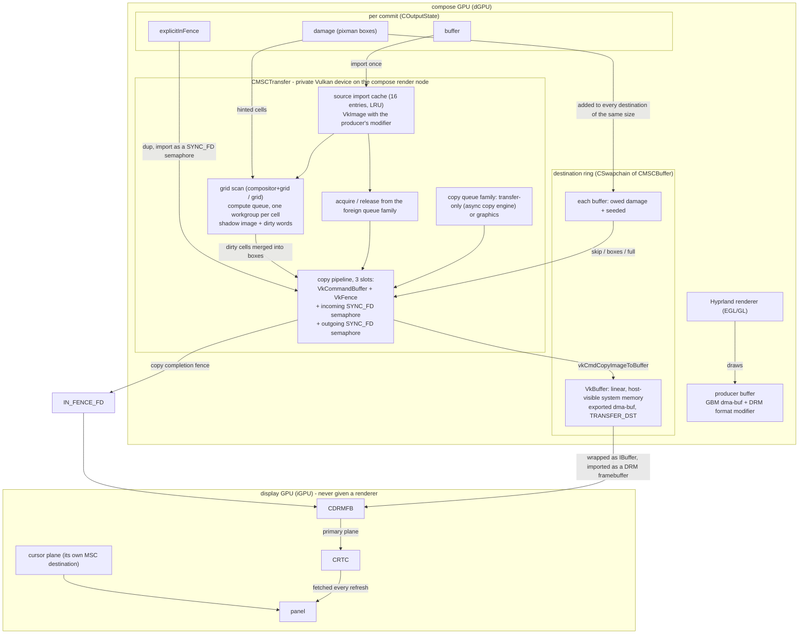
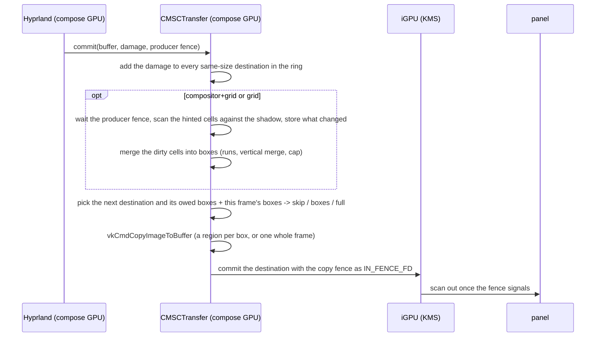

# Patches

What this fork adds on top of upstream Aquamarine `v0.15.1`, and how it works. Everything
is opt-in: with `AQ_MSC` unset the library behaves like upstream. Build and run
instructions are in [README.md](README.md).

## What it changes

**Muxless scanout copy.** On a muxless laptop the dGPU is the only usable renderer and the
iGPU is the only path to the panel. Upstream cannot cross that gap without a slow CPU
readback, because no format modifier is both renderable on the dGPU and displayable by the
iGPU. This patch lets the dGPU compose and copy the finished frame on its own GPU into a
buffer the iGPU can display, handing the copy's fence to the flip so nothing tears. The
iGPU is never given a renderer.

**Damage tracking.** The copy follows the region the compositor reports as changed: a
frame where nothing changed is skipped, a small change moves only that part, and it falls
back to a whole frame whenever it cannot be sure. `AQ_MSC_DAMAGE=0` copies whole frames.

**Teardown fixes.** Two crashes on exit, unrelated to the copy: a Vulkan destroy after the
NVIDIA driver's core library had unloaded, and an EGL debug callback formatting a null
driver string. Both only affected shutdown.

## Architecture

### One frame, end to end

1. Hyprland's **EGL/GL renderer** draws the frame on the compose GPU into a producer buffer,
   and commits it with the region it changed (`COutputState::damage`).
2. The frame leaves EGL as a plain **dma-buf** - a file descriptor, a DRM format modifier,
   a stride and an offset. MSC never touches EGL, it imports that dma-buf into Vulkan on the
   same GPU (see *The source import*).
3. The damage is turned into the boxes the copy has to move (see *Damage tracking*), and in the
   grid modes it is scanned against the previous frame first (see *The grid damage pass*).
4. On the compose GPU's Vulkan device the copy reads the source image and writes those boxes
   into the **destination buffer**, a linear system-memory dma-buf (see *The destination
   buffer*).
5. The destination dma-buf is imported on the **display GPU** as a DRM framebuffer and put on
   the CRTC's primary plane with the copy's fence as `IN_FENCE_FD` (see *Synchronization*).
   The display GPU then fetches it out of system memory on every refresh - it never renders.

### Where the frame comes from (EGL)

Under MSC the frame is still produced by the ordinary EGL/GL renderer on the compose GPU; MSC
is downstream of it. What it takes from the renderer is only the resulting buffer's dma-buf
descriptor, so the two sides never share a GL context and there is **no EGL interop, no
`EGLImage`, no readback**:

- the producer buffer was allocated by the compositor's own allocator (GBM) with a DRM format
  modifier, the same buffer Hyprland would have handed to any other backend;
- MSC imports it directly with `vkCreateImage` +
  `VkImageDrmFormatModifierExplicitCreateInfoEXT` (the producer's modifier and plane layout),
  binds the dma-buf fd as the image memory, and reads it as a transfer source;
- because the buffer is shared, each copy acquires it from the foreign queue family and
  releases it back afterwards.

### How it reaches the panel (i915)

- the destination buffer is exported by Vulkan as a dma-buf and wrapped as an ordinary
  `IBuffer`; Aquamarine imports it as a DRM framebuffer on the display GPU;
- the display GPU's CRTC is programmed with that framebuffer, and i915 is told to wait for the
  copy through `IN_FENCE_FD` (or the copy is waited on before the commit when the CRTC has no
  explicit sync);
- from then on i915 just fetches the linear buffer out of system memory every refresh. The
  hardware cursor is the same idea on the cursor plane, with its own small destination buffer.

### The copy engine

`CMSCTransfer` owns a private Vulkan device on the **compose GPU**, matched by DRM render
node: it enumerates physical devices, reads `VkPhysicalDeviceDrmPropertiesEXT`, and picks
the one whose render node is the compose backend's `drmRenderNodeFD()` - no vendor guess.
The instance and device are created with `DISPLAY` hidden, because the NVIDIA ICD opens an
X display during init and blocks if nothing answers.

The copy is submitted to one queue family, chosen up front and with no fallback:

- `AQ_MSC_QUEUE=transfer` - a family that has `TRANSFER` but neither `GRAPHICS` nor
  `COMPUTE`, i.e. the dedicated async copy engine, so the copies do not compete with the
  compositor's rendering for the graphics engine;
- `AQ_MSC_QUEUE=graphics` - a `GRAPHICS` family. Refused if the requested family does not
  exist.

The grid scan is not a transfer command, so it does not run on that family: when a grid mode is
active it gets a queue of its own from the compute-capable family (a second queue from the same
family when the copy already uses one).

The device is created with the external-memory and external-semaphore extensions,
`VK_EXT_image_drm_format_modifier` (for the modifier import) and
`VK_EXT_queue_family_foreign`, and the copy runs through a **three-deep pipeline**: three
command buffers, each with its own fence, its own exportable completion semaphore, and its
own incoming semaphore. A slot is only reused once its fence has signalled; that wait (plus
the host-wait fallbacks below) is where the compositor thread can block on the GPU.

### The source import

A producer buffer is imported **once** and cached. The import creates a `VkImage` from the
buffer's dma-buf with the producer's DRM format modifier
(`VkImageDrmFormatModifierExplicitCreateInfoEXT`, tiling `DRM_FORMAT_MODIFIER`) and usage
`TRANSFER_SRC` (plus `SAMPLED` while a grid mode is active, for the scan), then binds the
dma-buf fd as its memory. Entries are keyed by the buffer,
its format, modifier, size, stride and offset, kept while the compositor still holds the
buffer, and evicted least-recently-used once the cache is full (16 entries), never while a
copy that reads them is still in flight.

Because the image is shared, it belongs to the **foreign** queue family between copies:
each copy acquires it (`VK_QUEUE_FAMILY_FOREIGN_EXT` -> the copy family), reads it, and
releases it back. Repeated acquires without a release in between are invalid, so the
acquire/release pair is recorded on every copy.

### The destination buffer

The destination is a `VkBuffer` with an external dma-buf handle, usage `TRANSFER_DST`,
exported as a dma-buf and wrapped as an `IBuffer` (`DRM_FORMAT_MOD_LINEAR`). Two choices
force the rest of the design:

- **system memory**, not device-local. It is allocated from a host-visible, host-coherent
  heap, preferring one that is *not* device-local: a device-local (BAR/VRAM) buffer cannot
  be fetched by the display GPU and its commit fails.
- **linear, 256-aligned stride** (`mscStrideFor`), so the same buffer is valid on the
  display GPU's primary plane and on its cursor plane.

The destination buffers are allocated through a `CSwapchain`, which is the ring the copy
rotates through.

### Synchronization

Everything is kept on the GPU where possible:

- the producer's fence (`explicitInFence`) is `dup`'d, imported as a `SYNC_FD` semaphore on
  the slot, and the queue waits on it before the copy (at `ALL_COMMANDS`: a queue-family
  transfer does not run in a defined stage, so a narrower wait would not order it); if the
  import is refused, the copy falls back to polling the fence on the host;
- the copy's completion is the slot's outgoing semaphore exported as a `SYNC_FD`, returned
  as the commit's in-fence. When the CRTC has no explicit sync, KMS would drop the fence,
  so the copy is waited on before the commit instead (debug toggle `AQ_MSC_NO_FENCE=1`
  skips that, and the panel can then show a half-copied frame);
- the cursor copy is always waited on before the framebuffer is handed over, because a
  cursor commit does not carry the in-fence.

`scanGPUs` refuses to start if `AQ_MSC=1` is set with a bad `AQ_MSC_COPY`/`AQ_MSC_QUEUE`,
or without both GPU roles - there is no auto-detection and no fallback.

### Damage tracking

The copy moves only what the compositor changed. Each destination buffer remembers the
damage it still **owes**, because the destination is a ring: a buffer written two frames
ago has to catch up on the frames it sat out. Every frame's reported damage is added to
every destination of the same size in the ring, and a destination clears its owed set once
it has been written again.

Per copy, the owed set is clipped to the frame and decides the mode:

- **skip** - nothing owed, so the frame is already there: no copy, no fence at all;
- **partial** - only the owed boxes are copied, as one `VkBufferImageCopy` per box
  (`imageOffset` picks the box in the source frame, `bufferOffset` places it at the same
  coordinates in the destination, `bufferRowLength` is the destination row length in pixels,
  the stride / 4);
- **full** - the whole frame, used when the tracking cannot be trusted: a destination that
  has never been filled, a frame with no reported damage, or nearly the whole frame (90%)
  changed. A partial copy is one box per rect and a box's rows are contiguous, so copying 90%
  as boxes costs about what a whole frame costs. The owed set is merged down to the rectangle
  cap before this decision, so the number of boxes on its own no longer forces a whole frame.

`AQ_MSC_DAMAGE` picks where the boxes come from: `compositor` (the default) follows the reported
damage, `compositor+grid` and `grid` add the scan (see *The grid damage pass*), and `0` copies whole
frames.

The engine also reports its counters (copies, waits, the damage distribution, why frames were
copied whole, and for the grid modes the cells scanned, how many were dirty and the scan's time per
frame) once every 60 s; `AQ_MSC_STATS=<seconds>` changes the interval and `AQ_MSC_STATS=0` turns the
reports off.

### The grid damage pass (`compositor+grid` and `grid`)

The copy can check the reported damage against the pixels before it records anything. `compositor` (the default) keeps the reported damage without the scan; `compositor+grid` adds the scan.

- The scan runs on a compute queue of its own: a second queue from the compute-capable family, or
  a second queue from the copy family when the two are the same. The copy keeps the family it was
  given. The host orders the two - the dirty map has to be back before the copy can be recorded -
  so no semaphore crosses the queues, but the source image is acquired for the scan family and
  released back to the foreign family before the copy acquires it for its own.
- The shadow is a device-local image of the frame's size and format. One workgroup per cell
  compares the source against it with raw texel values (the alpha channel is ignored: an XRGB source
  carries nothing there), stores the differing pixels back into the shadow and sets the cell's dirty
  word. The first scan after the shadow is created stores the source instead of comparing, so a
  fresh shadow can never hide a change.
- Only the cells the compositor's damage covers are scanned. `grid` mode has no hint and scans the
  whole grid. A scan that cannot run leaves the reported damage in place, or the whole frame when
  there was none: it is never treated as "nothing changed".
- Dirty cells become copy rectangles through horizontal runs inside a cell row, a vertical merge of
  runs that share an x range, and cheapest-pair merges until the rectangle cap is reached. Every
  rectangle is clipped to the frame. The merge is a pure function with a unit test of its own.
- The shadow is per frame, not per destination: it answers "what did the frame look like when we
  last scanned it", while each destination's owed set answers "what is this buffer still missing".
  The ring stays correct because of the owed set, not because of the shadow.
- `AQ_MSC_DAMAGE_BLINK=1` overlays the regions the copy moves with a translucent red tint, blended
  from the real source so the picture stays readable and the regions are visible. Because the
  destinations rotate, the regions painted last time are copied from the real source again on the
  next write and only this frame's damage is painted; without that restore the ring would accumulate
  red. The shadow is always updated from the real source.
- The copy's rectangle list is the destination's owed set, so the same merge bounds it: the owed
  strips are merged down to the cap instead of falling back to a whole frame. Cursor copies (no
  damage, no wait fd, at most 256 px) are excluded entirely - they are a different plane and must
  not resize the frame-sized shadow or blink image while a copy is in flight.
- Capability failures refuse to start with the reason: a device with no compute queue, an
  unsupported cell size, or a pipeline that cannot be created. There is no silent fallback, and a
  pass whose fence wait times out is skipped in favour of the reported damage.

### Why the scan is not gated on the size of the hint

A gate like "skip the scan when the compositor reports most of the frame" looks cheap and is wrong for
the case the pass exists for. Software that does not report damage - it repaints its whole surface
instead - leaves the compositor no way to know which parts really changed, so the whole surface is
reported as damaged and a large-hint gate would disable the scan exactly where it pays. The scan is
the only thing that can tell "reported everything" from "changed everything", and its cost is accepted
in the modes that ask for it. A frame budget too small for the scan (very high frame rates) is handled
by leaving the mode off, not by guessing from the hint.

### The display side, failure, and teardown

- The display GPU **never gets an EGL renderer** (the secondary-renderer path returns early);
  it only keeps its KMS device. The cursor is handled like a frame, copied into its own small
  destination (see *The destination buffer*).
- A **fatal copy failure** marks the engine bad; the next commit rebuilds it - dropping the
  transfer and its allocator, which makes the destination swapchains reallocate - up to 4 times
  per failure episode, and the budget resets once a rebuilt engine has actually copied a frame.
  After that the outputs freeze with the log saying why. What counts as fatal is anything the
  engine cannot recover from in place: a lost device, a copy slot that never signalled, a
  submission that failed after its fence had been reset, or a completion fence that could not be
  exported (the export is what makes the slot's semaphore reusable).
- On **exit**, the process' static destructors can run after the NVIDIA driver's core
  library has been unloaded, so a plain `vkDestroyDevice` faults. An `atexit` handler
  marks the exit and the destructors then leak the Vulkan objects instead of calling into
  a dead driver (`Deliberate simplification` in the source; a deterministic backend
  teardown would remove the need).

## Where the code lives

Only a few places are touched. The essential ones:

**`src/backend/drm/ScanoutCopy.{hpp,cpp}`** (new)

- `CMSCTransfer` - the private Vulkan device on the compose render node, `copy()` (the
  per-commit copy plus the skip/damage logic), `acquireSource()` / `evictIdleSources()`
  (the import cache), `allocateDestinationStorage()` / `freeDestinationStorage()`, and the
  three-slot fence and semaphore pipeline.
- `scanInit()` / `scanRun()` / `ensureBlink()` - the grid scan and the blink overlay; the shader
  is `scan_grid.comp` and its SPIR-V is `MSCScanGridSpirv.hpp` (generated, checked in).
- `CMSCBuffer` - one destination buffer plus the damage it still owes (`pendingDamage`,
  `seeded`, `markSynced`, `accumulateDamage`) and the blink regions it last painted.
- `CMSCAllocator` - hands destinations to the swapchain.
- `mscStrideFor` / `mscVkFormat` - the pure helpers, covered by a unit test, and `mscMergeCells`,
  the rectangle merge, covered by `tests/ScanoutCopyDamage.cpp`.

**`src/backend/drm/DRM.cpp`**

- `scanGPUs()` - pins the GPU roles and validates the `AQ_MSC*` environment (refuses to
  start on a bad value).
- `mscEnabled()` / `mscTransfer()` / `mscAllocator()`, and the renderer skip in
  `updateSecondaryRendererState()`.
- `mscReady()` (the transfer and allocator for a commit, or "engine unavailable") and
  `mgpuNextBuffer()` (the destination-buffer helper shared by the async, sync and cursor
  paths).
- the commit paths `prepareAsyncCommitData()` and `commitState()`, and `setCursor()` -
  where the copy and its fence are wired in.

**`src/backend/drm/Renderer.cpp`** - `eglLog()`, made null-safe.

**`src/backend/drm/impl/Atomic.cpp`** - commit-failure logging and the `AQ_ATOMIC_DEBUG` dump.

**`CMakeLists.txt`** - the Vulkan dependency and the `ScanoutCopyFormat` test.
