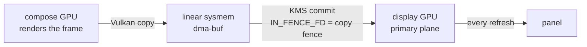

# Aquamarine Muxless Scanout Copy

A patched Aquamarine for **muxless laptops**, where the dGPU is the only usable
renderer and the iGPU is the only path to the panel: the dGPU composes, the iGPU
only scans out. Base: upstream `v0.15.1` - the unmodified readme is
[README.aquamarine.md](README.aquamarine.md).

## What this is

- The compose GPU renders the frame; the display GPU is never given a renderer.
- The composed buffer is copied, still on the compose GPU, into a linear
  system-memory buffer the display GPU can fetch, and the flip is committed on
  the display GPU with the copy's fence as `IN_FENCE_FD`.
- Opt-in: with `AQ_MSC` unset the behaviour is stock Aquamarine.

## How it works



The producer fence is imported as a semaphore and waited on the GPU, and the copy's
own fence becomes the flip's `IN_FENCE_FD`. The display GPU only programs its plane;
it is never given a renderer.

Why this is not a blit: no DRM modifier is both renderable on the compose GPU and
scannable by the display GPU, so an EGL blit on the display GPU cannot land in a
buffer it can also scan out - upstream then falls back to a CPU readback, which is
the cost this patch removes.

## Usage

Build (Vulkan and its headers are required):

```sh
cmake -S . -B ./build -G Ninja -DCMAKE_BUILD_TYPE=Release
cmake --build ./build --parallel
```

Hook: Hyprland has to load the built library. It keeps the upstream soname
(`libaquamarine.so.14`), so pointing the session's `LD_LIBRARY_PATH` at the build
directory is enough. For a uwsm session, in `~/.config/uwsm/env`:

```sh
export LD_LIBRARY_PATH="$HOME/path/to/aquamarine-msc/build"
```

Environment - all roles are explicit, there is no auto-detection and no fallback:

```sh
export AQ_MSC=1                        # 0|1 switch
export AQ_MSC_COPY=vulkan              # how the copy is performed (vulkan is the only one)
export AQ_MSC_QUEUE=transfer           # transfer (async copy engine) | graphics
export AQ_MSC_DISPLAY=/dev/dri/card1   # gpu display (display only)
export AQ_MSC_COMPOSE=/dev/dri/card0   # gpu compose
```

The GPU paths are whatever your dGPU and iGPU card nodes are; `by-path` links work
too. An extra GPU is left unmanaged (the log says so).

Compositor side: `cursor:no_hardware_cursors = 0` is required. Without it Hyprland
chooses a software cursor on NVIDIA plus multi-GPU, which `AQ_MSC` makes true, and
the pointer is then composited into the frame.

## Limits

- the whole frame is copied per commit, so there are no partial (damage) copies;
- a second output on the display GPU is untested;
- HDR / 10-bit, scaled modes and multi-GPU output are untested;
- there is no blit fallback and no queue fallback: if the copy cannot be built, or
  `AQ_MSC_QUEUE=transfer` is asked for on a device without a transfer-only family,
  the session refuses to start and the log says why;
- Vulkan is linked unconditionally, so `libvulkan` is loaded even with `AQ_MSC` off.
