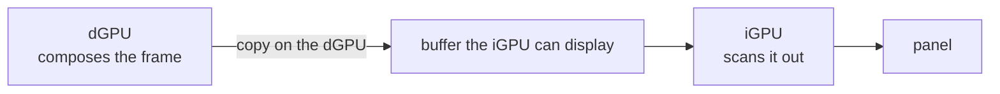

# Aquamarine Muxless Scanout Copy

A patched Aquamarine for **muxless laptops**, where the dGPU is the only usable
renderer and the iGPU is the only path to the panel: the dGPU composes, the iGPU
only scans out. Base: upstream `v0.15.1` - the unmodified readme is
[README.aquamarine.md](README.aquamarine.md). A one-page summary of what the patch changes
is in [PATCHES.md](PATCHES.md).

## What this is

- The dGPU composes the frame; the iGPU is only used to put it on the panel, and is never
  given a renderer.
- The finished frame is copied on the dGPU straight into a buffer the iGPU can display, so
  it never has to pass through the CPU.
- Opt-in: with `AQ_MSC` unset the behaviour is stock Aquamarine.

## How it works



The usual route - having the iGPU copy the finished frame - does not work on this
hardware: no format modifier suits both GPUs, so it falls back to a slow round trip through
the CPU. This patch copies the frame on the dGPU instead, into a buffer the iGPU can
display directly, and the iGPU only ever scans it out.

The copy only moves what changed on screen: a frame where nothing changed is skipped
entirely, and a small change moves only that part of the frame. It falls back to copying
the whole frame whenever it cannot be sure what changed.

## Usage

Build (Vulkan and its headers are required):

```sh
cmake -S . -B ./build -G Ninja -DCMAKE_BUILD_TYPE=Release
cmake --build ./build --parallel
```

Hook: Hyprland has to load the built library. It keeps the upstream soname
(`libaquamarine.so.14`), so pointing the session's `LD_LIBRARY_PATH` at the build
directory is enough. For a uwsm session, in `~/.config/uwsm/env`:

```sh
export LD_LIBRARY_PATH="$HOME/path/to/aquamarine-msc/build"
```

Environment. `AQ_MSC` is the switch: with it unset (or `0`) nothing below takes effect and the
library is stock Aquamarine. With `AQ_MSC=1` every choice is explicit - there is no
auto-detection, and an invalid value for one of the required variables refuses to start and says so
in the log:

| Variable | Required | Values | Meaning |
| --- | --- | --- | --- |
| `AQ_MSC` | to enable | `1` | enable the scanout copy; `0`/unset is stock Aquamarine, anything else refuses |
| `AQ_MSC_COPY` | yes | `vulkan` | how the copy is performed (`vulkan` is the only value) |
| `AQ_MSC_QUEUE` | yes | `transfer` \| `graphics` | the queue family the copy is submitted to: `transfer` = the async copy engine (needs a transfer-only family on the compose GPU, and there is no fallback), `graphics` = the 3D engine |
| `AQ_MSC_COMPOSE` | yes | a card node, e.g. `/dev/dri/card0` | the GPU that renders the frame and runs the copy |
| `AQ_MSC_DISPLAY` | yes | a card node, e.g. `/dev/dri/card1` | the GPU that only scans out |
| `AQ_MSC_DAMAGE` | no | `1` (default) \| `0` | follow the compositor's damage and copy only what changed; `0` copies whole frames. Anything but `0` counts as on. |
| `AQ_MSC_STATS` | no | seconds (default `60`) \| `0` | how often the engine logs its counters (copies, waits, damage distribution, why frames were copied whole); `0` turns the reports off. A negative or unparsable value also turns them off, silently. |

Debug only:

| Variable | Value | Effect |
| --- | --- | --- |
| `AQ_MSC_NO_FENCE` | `1` | commit the destination without the copy's in-fence, to tell a bad framebuffer apart from a fence KMS refuses. The panel can then show a half-copied frame. |
| `AQ_TRACE` | `1` | Aquamarine's per-frame trace logging (upstream), when the counters above are not enough |

```sh
export AQ_MSC=1
export AQ_MSC_COPY=vulkan
export AQ_MSC_QUEUE=transfer
export AQ_MSC_DISPLAY=/dev/dri/card1   # the display GPU
export AQ_MSC_COMPOSE=/dev/dri/card0   # the compose GPU
```

The GPU paths are whatever your dGPU and iGPU card nodes are; `by-path` links work
too. An extra GPU is left unmanaged (the log says so).

Clients should be pinned to the compose GPU too, or one of them picks the scanout GPU and its
frames need exactly the cross-GPU path this patch exists to avoid:

```sh
export __EGL_VENDOR_LIBRARY_FILENAMES=/usr/share/glvnd/egl_vendor.d/10_nvidia.json
export __GLX_VENDOR_LIBRARY_NAME=nvidia
export VK_DRIVER_FILES=/usr/share/vulkan/icd.d/nvidia_icd.json
export LIBVA_DRIVER_NAME=nvidia
```

(Those are the NVIDIA paths; use your compose GPU's ICD and vendor library. A `uwsm` session reads
all of the above from `~/.config/uwsm/env`.)

Compositor side: `cursor:no_hardware_cursors = 0` is required. Without it Hyprland
chooses a software cursor on NVIDIA plus multi-GPU, which `AQ_MSC` makes true, and
the pointer is then composited into the frame.

## Limits

- the damage copy pays only for small changes: full-screen content (video, scrolling, games)
  still moves whole frames;
- a second output on the display GPU is untested;
- HDR / 10-bit, scaled modes and multi-GPU output are untested;
- there is no fallback: if the copy cannot be built, or the requested queue is not
  available, the session refuses to start and the log says why;
- Vulkan is linked unconditionally, so `libvulkan` is loaded even with `AQ_MSC` off.
